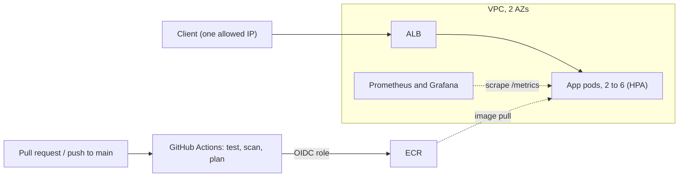
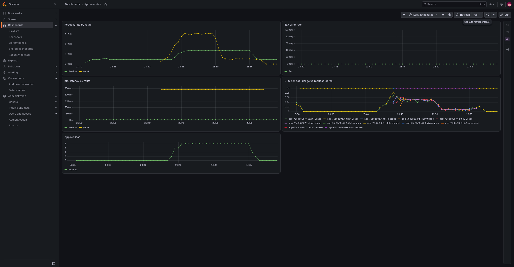

# AWS EKS Platform

A small web service running on AWS EKS, built to practice running something the way a team would: infrastructure in Terraform, images built and scanned by GitHub Actions with no stored AWS keys, metrics in Prometheus and Grafana, and pod autoscaling. I also tested the claims instead of only stating them, and the numbers are below.

**Status:** complete. There is no live endpoint, because the cluster is destroyed between sessions. See [Reproduce it](#reproduce-it).

## Results at a glance

Everything below was measured on this cluster (two t3.medium nodes across two availability zones in us-east-1), from one laptop, in single runs, so the numbers are indicative.

- **Autoscaling:** under a ramp to 3 requests per second, the HPA went from 2 to 6 pods in 75 seconds. It was back to 2 about 6 minutes after the load dropped.
- **Load test:** 1424 requests over 15 minutes, 99.86% succeeded, p95 latency 274 ms end to end, including the network distance from my laptop to us-east-1. The 2 failures were stalls of about 10 seconds that I couldn't explain.
- **Pod deleted:** the replacement was ready in about 2 seconds, and 119 of 120 requests succeeded during the test.
- **Node terminated:** 299 of 300 requests succeeded, and a replacement node was Ready about 62 seconds later.
- **Rebuild:** the cluster takes 16m31s to create, 4m45s to deploy onto, and 12m14s to destroy.



## Architecture

**Network.** One VPC (10.0.0.0/16) across two availability zones. The private subnets are /20 because pods take their IP addresses from the VPC, and they hold the nodes. The public subnets are /24 and hold the load balancer and the NAT gateway. There is a single NAT gateway: cheaper, but one point of failure.

**Cluster.** EKS on Kubernetes 1.36 from the community Terraform module. There is one managed node group of two t3.medium nodes (minimum 2, maximum 3). Nothing adds nodes automatically, so autoscaling here means pods only. Add-ons: CoreDNS, kube-proxy, VPC CNI, and the Pod Identity agent. All control plane log types are enabled, kept for 365 days.

**Installed into the cluster** by `scripts/deploy.sh` with Helm, not by Terraform:
- AWS Load Balancer Controller 3.6.3, which creates the ALB from the Ingress. It gets its AWS permissions through Pod Identity.
- kube-prometheus-stack 93.6.0 (Prometheus, Grafana, and Alertmanager).
- metrics-server 3.14.0, which the HPA needs to read CPU.

**The app** is a small Python service with `/healthz`, `/work` (burns CPU for a requested number of milliseconds, used for load tests), and `/metrics`. It runs as a Deployment of 2 replicas with a 100m CPU request and no CPU limit. A HorizontalPodAutoscaler scales it between 2 and 6 pods at 50% CPU. An Ingress exposes it through the ALB, and the ALB only accepts traffic from one IP address, which is a development setting. Prometheus scrapes `/metrics` every 15 seconds, and the Grafana dashboard is stored in the repo as JSON.

**Terraform** is split in two folders. `bootstrap` holds what must outlive the cluster: the S3 bucket for state (versioned, encrypted, no public access), the ECR repository, and the GitHub OIDC roles. `platform` holds the cluster itself (60 resources). That way I can destroy and rebuild the platform without touching state, images, or roles.

## CI/CD

Three GitHub Actions workflows. None of them deploys to the cluster: deploying is manual (`scripts/deploy.sh`), and so is `terraform apply`.

- **On every pull request (`ci.yml`):** installs the app's dependencies, runs the tests, builds the image, and scans it with Trivy. The scan fails the pull request on any HIGH or CRITICAL vulnerability that has a fix available.
- **On pull requests that touch `terraform/platform` (`terraform.yml`):** runs Checkov on the Terraform, then a `terraform plan`. The plan uses a read-only AWS role (apart from the state lock file) that GitHub assumes through OIDC.
- **On merge to `main` when the app changes (`push.yml`):** builds and scans the image in a job with no AWS credentials. A second job loads that exact image and pushes it to ECR, tagged with the commit hash, using a role that can only push to that one repository. It skips the push if the tag already exists.

AWS access works through OIDC: GitHub gives each run a short-lived token, and AWS exchanges it for temporary credentials, so no long-lived AWS keys are stored in GitHub. Each role trusts one specific repository and event: pull requests for the plan role, and the main branch for the push role. Third-party actions are pinned to full commit hashes, and GitHub's own actions are pinned to version tags.

## Design decisions

**Pod Identity, not IRSA, for the load balancer controller.** I rebuild the cluster often. IRSA needs a new OIDC provider and a trust policy update every time, while Pod Identity trusts the EKS service once. The cost is an extra add-on, and Pod Identity is newer than IRSA.

**Pods autoscale, nodes don't.** The node group is a fixed two t3.medium nodes, which was enough for 6 pods in the test. If demand outgrew them, pods would sit in Pending. Karpenter or the Cluster Autoscaler would fix that.

**One NAT gateway for both availability zones.** It is cheaper than one per zone. The cost is that if the zone holding the gateway failed, the nodes in the other zone would lose outbound internet access.

**Helm and manifests are applied by a script, not by Terraform or GitOps.** Terraform stays on the AWS side, so destroy and rebuild stay simple. The cost is that nothing detects drift or syncs the cluster back to the repo. Argo CD or Flux would do that.

**A 100m CPU request, no CPU limit, and scaling at 50%.** The small request lets the HPA react at the request rates one laptop can generate, and having no limit avoids CPU throttling. The cost is that the HPA percentage depends entirely on the 100m figure, and one busy pod can take CPU from its neighbors. In production I'd set the request from measured usage.

## Tested results

These are single runs from one laptop, so treat the numbers as estimates.

### Autoscaling

k6 ramped from 0.5 to 3 requests per second over 15 minutes, with 100 ms of work per request. Of 1424 requests, 2 failed. The median was 250.4 ms and p95 was 273.7 ms.

From the `kubectl get hpa -w` log:

- First scale-up at 23:43:39, and 6 replicas at 23:44:54 (75 seconds).
- The load began to fall at about 23:49:10. The first scale-down was at 23:55:11, and 2 replicas were back at 23:55:56.
- At 6 pods, CPU sat near 50%, at about 100 ms of CPU per request. So 6 pods was roughly what 3 requests per second needed, and the HPA wasn't clearly at its maximum.



*The Grafana dashboard across the full cycle, with app replicas peaking at 6. The dashboard's p95 for `/work` reads about 225 ms for 100 ms of work, probably because of the histogram bucket width, which I haven't checked. k6 measured 273.7 ms end to end.*

### Failure tests

**Pod kill.** During a 120-request loop at 1 request per second, I deleted one app pod. The replacement was ready in about 2 seconds, and 119 of 120 requests succeeded. The one failure was a 5 second timeout, 72 seconds after the delete.

**Node kill.** During a 300-request loop, I terminated one node's EC2 instance, and 299 of 300 succeeded. The one failure was a 3 second timeout, 5 seconds after the terminate. A replacement app pod was ready in about 12 seconds, and the replacement node was Ready after about 62 seconds.

Nothing moves running pods back after a node loss. Both app pods then ran on the same node for about 3 minutes, and a second node loss in that window would have taken both.

### What these tests don't show

- I never found the cause of the 3 stalls (2 in the k6 run, about 10 seconds each, and 1 in the pod kill). The app recorded no 5xx errors, and the node-kill timeout coincided with the node loss.
- The EC2 terminate is graceful, since the kubelet reported a node shutdown. A hard crash may behave differently, and I didn't test one.

## Security

The OIDC setup and action pinning are covered under CI/CD.

**Scoped roles.** There are three GitHub roles, one per job. The plan role is read-only and only works from pull requests. The push role can only push to the one ECR repository, from `main`. The trust policies are tied to this repository by name and by numeric ID.

**No account details in the repo.** The role ARNs and role IDs are GitHub secrets, so they're not in any file. The workflows also mask the role ID and the AWS account ID in the logs.

**Limited exposure.** The nodes are in private subnets, and the ALB only accepts traffic from my IP, which is set when I deploy.

**Secrets encryption.** The Terraform plan shows Kubernetes secrets encrypted with a KMS key.

## Cost

I destroy the cluster after every session, so I only pay while it's running. At us-east-1 list prices, it costs about $0.27 per hour:

| Item | Price | Per hour |
| --- | --- | --- |
| EKS control plane (standard support) | $0.10 per hour | $0.10 |
| 2 t3.medium nodes | $0.042 per hour each | $0.084 |
| NAT gateway | $0.045 per hour, plus $0.045 per GB | $0.045 |
| Application Load Balancer | $0.0225 per hour, plus usage | $0.0225 |
| 3 public IPv4 addresses | $0.005 per hour each | $0.015 |

A 3-hour session costs about $0.80. Left running, the same setup would cost about $6.40 a day, which is why it gets destroyed.

The total leaves out EBS volumes, CloudWatch logs, data transfer, and the ALB's usage charges, which are small at this traffic.

## What I would change in production

**Security.**

- Restrict the API endpoint. It's open to 0.0.0.0/0 so `kubectl` works from my VM, and IAM authentication still applies.
- Serve HTTPS. The ALB has no certificate configured, so it serves HTTP only. I'd add a domain and an ACM certificate.
- Scope down or remove the apply role. It has AdministratorAccess, and nothing uses it yet.
- Scan `terraform/bootstrap` with Checkov, and verify the four skipped checks. The plan confirms the secrets encryption one, but I haven't checked the others.
- Pin GitHub's own actions by commit SHA. Only the third-party ones are pinned today.

**Resilience.** Add topology spread constraints and a PodDisruptionBudget. In the node test, both app pods ran on the same node for about 3 minutes, because nothing moves pods back after a node loss.

**Observability.** Give Prometheus persistent storage, since its data is lost when the pod restarts. Use finer histogram buckets around 100 ms, so the p95 on the dashboard is more accurate.

**Manifests.**

- Remove `replicas` from the Deployment. Kubernetes says not to set it when an HPA manages the count.
- Set the memory request and limit from measured usage.

## Reproduce it

This is how to bring it up.

**Prerequisites.** An AWS account that already has the GitHub OIDC provider, plus the AWS CLI, Terraform 1.10 or later, kubectl, Helm, and Docker. If you fork the repo, change the GitHub owner and repo IDs in `terraform/bootstrap/github-oidc.tf`, and the state bucket name in both backend blocks.

**Bootstrap.** This creates the state bucket, the ECR repository, and the GitHub roles. The bucket holds bootstrap's own state, so the first apply has to use local state. Remove `backend.tf`, then run `terraform init` and `terraform apply` in `terraform/bootstrap`. Then restore `backend.tf` with the new bucket name and run `terraform init -migrate-state`.

**Image.** Push the app image to the ECR repository. The push workflow does this on a push to `main`.

**Build and deploy.** The platform takes about 16 minutes, and the deploy script about 5.

```bash
terraform -chdir=terraform/platform init
terraform -chdir=terraform/platform apply
IMAGE_TAG=<tag> ./scripts/deploy.sh
```

The script installs the load balancer controller, Prometheus and Grafana, and metrics-server. It applies the manifests with the ALB restricted to your IP, then waits for the ALB address. The ALB takes a minute or two more to become active after the address appears. To run the load test, pass the address to k6 with `-e BASE_URL=http://<ALB address>`.

**Tear down.** Delete the Ingress first, so the controller removes the ALB. Then wait until the ALB and its tagged security groups are gone, or the destroy hangs. Also check that no PersistentVolumeClaims or LoadBalancer Services are left.

```bash
kubectl delete ingress app
until [ "$(aws elbv2 describe-load-balancers --region us-east-1 --query 'length(LoadBalancers)' --output text)" = "0" ] && [ "$(aws ec2 describe-security-groups --region us-east-1 --filters Name=tag-key,Values=elbv2.k8s.aws/cluster --query 'length(SecurityGroups)' --output text)" = "0" ]; do sleep 10; done
terraform -chdir=terraform/platform destroy
```
